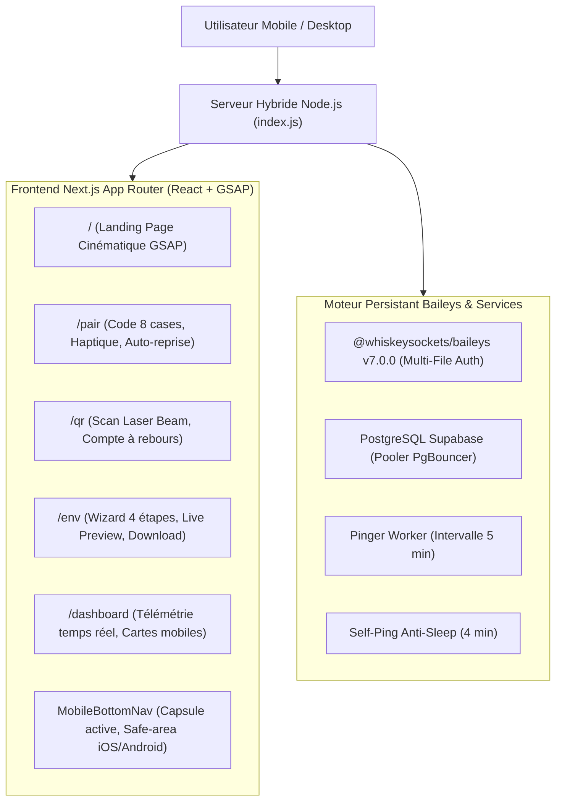

# Document de Passation Technique — Innovations UX, Animations GSAP & Roadmap

> **Projet :** MENMA-MD / Session Web  
> **Auteur :** Antigravity AI  
> **Date de mise à jour :** 18 Octobre 2026  
> **Statut :** Migration Next.js App Router finalisée • Production Ready  
> **Audience cible :** 99% d'utilisateurs sur smartphone (Design Mobile-First)  
> **Thème visuel :** Dark Luxury Gold (`#0a0a0c`, `#C8A84B`, Glassmorphism, DM Sans / DM Mono)  

---

## 1. Synthèse de l'Architecture Actuelle

Le projet a été intégralement migré d'une pile statique HTML/JS vers une architecture moderne **Next.js 16 (App Router) + React 19 + TypeScript + Tailwind CSS v4 + GSAP 3.15**.



---

## 2. Inventaire des Animations & Micro-Interactions Déjà en Place

| Composant / Page | Type d'animation | Technologie | Description & Ressenti Utilisateur |
| :--- | :--- | :--- | :--- |
| **Hero Section** | Split Cascades Stagger | GSAP Timeline | Révélation cadencée du badge protocole, des deux lignes de titre géant et des boutons d'action (`power3.out`). |
| **Bento Grid** | Micro-interactions | GSAP + React | Démo de copie de code interactive en direct, stepper 4 étapes cliquable et indicateur de santé serveur vivant. |
| **Live Terminal** | Log Ticker en direct | React Hooks + CSS | Ticker de logs simulant en boucle le handshake Baileys v7, le chiffrement Pastebin et le pinger PostgreSQL. |
| **Ambient Spotlight** | Halo doré réactif | GSAP `quickTo` | Suivi inertiel fluide du curseur sur ordinateur et orbes de respiration pulsée dorée sur mobile (`animate-pulse-slow`). |
| **Bottom Nav** | Capsule active dynamique | React + CSS Safe-area | Barre basse flottante respectant `env(safe-area-inset-bottom)`, retour tactile et capsule dorée marquant l'onglet actif. |
| **Page `/pair`** | 8 Cases segmentées | CSS + Haptique | Code affiché dans 8 tuiles numériques grand format avec effet de brillance (`animate-pulse-glow`) et vibration tactile (`navigator.vibrate`). |
| **Page `/pair`** | Résilience de tâche | API Page Visibility | Reprise instantanée du polling lorsque l'utilisateur revient de WhatsApp vers son navigateur sans recharger la page. |
| **Page `/qr`** | Faisceau Laser Scan | CSS Keyframes | Ligne laser dorée (`animate-laser-scan`) qui balaie le QR code de haut en bas avec anneau de compte à rebours 45s. |
| **Page `/env`** | Stepper & Live Preview | React State | Accordéon interactif 4 étapes avec synchronisation instantanée du bloc de code `.env` et boutons de copie/téléchargement. |
| **Page `/dashboard`** | Cartes adaptées | Tailwind + Lucide | Cartes de bots individuelles remplaçant les tableaux horizontaux qui débordent sur petits écrans. |

---

## 3. Boîte à Idées : Animations & Fonctionnalités "Cool" à Implémenter

Voici les améliorations de nouvelle génération recommandées pour faire de cette application une vitrine technologique incontournable :

### 3.1. Célébration dorée "Golden Confetti Burst" (Succès de Session)
> **Objectif :** Déclencher une explosion gratifiante de particules dorées dès que le Session ID est généré.
- **Principe :** Dès que le statut passe à `success` sur `/pair` ou `/qr`, déclencher un canvas de particules dorées ultra-léger (ex: `canvas-confetti`).
- **Impact mobile :** Effet "dopamine" immédiat validant que la connexion WhatsApp a parfaitement fonctionné.

### 3.2. Micro-retours Audio "Luxury Haptics" (Clics & Confirmations)
> **Objectif :** Ajouter une dimension sonore subtile inspirée des interfaces Apple iOS et Linear.
- **Principe :** Synthétiser via l'API Web Audio native (quelques octets de code, zéro fichier MP3 lourd) un son de "pop" velouté lors de l'appui sur un bouton et un son "chime" discret lors de la copie réussie.
- **Exemple de code synthétiseur :**
```typescript
export function playHapticSound(type: 'tap' | 'success' = 'tap') {
  if (typeof window === 'undefined') return;
  const ctx = new (window.AudioContext || (window as any).webkitAudioContext)();
  const osc = ctx.createOscillator();
  const gain = ctx.createGain();
  osc.connect(gain);
  gain.connect(ctx.destination);
  
  if (type === 'tap') {
    osc.frequency.setValueAtTime(400, ctx.currentTime);
    gain.gain.exponentialRampToValueAtTime(0.001, ctx.currentTime + 0.08);
    osc.start();
    osc.stop(ctx.currentTime + 0.08);
  } else {
    osc.frequency.setValueAtTime(587.33, ctx.currentTime); // D5
    osc.frequency.setValueAtTime(880, ctx.currentTime + 0.08); // A5
    gain.gain.exponentialRampToValueAtTime(0.001, ctx.currentTime + 0.25);
    osc.start();
    osc.stop(ctx.currentTime + 0.25);
  }
}
```

### 3.3. Gestes Tactiles de Glissement "Swipe Gestures" sur le Wizard `.env`
> **Objectif :** Permettre de passer d'une étape à l'autre d'un simple balayage du pouce sur l'écran.
- **Principe :** Écouter les événements `touchstart` et `touchend` pour basculer naturellement entre les étapes 1, 2, 3 et 4 avec transition par glissement horizontal GSAP (`x: -100%` $\rightarrow$ `x: 0`).

### 3.4. Dynamic Island / Notification Toast Flottante
> **Objectif :** Feedback visuel élégant façon iOS Dynamic Island en haut de l'écran lors d'une copie.
- **Comportement :** Au lieu d'un texte statique "Copié !", une capsule noire aux contours dorés s'étire depuis le haut de l'écran avec une animation de ressort physique (`elastic.out`).

### 3.5. Support PWA (Progressive Web App) "Installer l'App"
> **Objectif :** Permettre aux 99% d'utilisateurs mobiles d'installer MENMA-MD directement sur l'écran d'accueil sans passer par le Play Store / App Store.
- **Fichiers nécessaires :** `public/manifest.json` avec icône dorée 192x192 et 512x512, et configuration `display: "standalone"`.
- **Avantage :** Supprime la barre d'adresse du navigateur mobile, procurant l'impression d'une application native 100% plein écran.

### 3.6. Anneau 3D Doré "Three.js Golden Ring" dans le Hero
> **Objectif :** Remplacer le badge ou l'arrière-plan du Hero par un anneau torique 3D doré flottant qui réagit au gyroscope du smartphone (`DeviceOrientationEvent`).

---

## 4. Guide de Déploiement & Maintenance

### 4.1. Dépôts Git Officiels
- **Dépôt Applicatif Web :** `git@github.com:Dr-Djibi/Menma-Session.git` (Branche `main`)
- **Dépôt Image Docker :** `git@github.com:Dr-Djibi/SESSION_MENMA.git` (Branche `main`)

### 4.2. Commandes Utiles de Développement
```bash
# Lancement en développement (Next.js HMR)
npm run dev

# Compilation de production
npm run build

# Démarrage du serveur hybride de production (Next.js + Baileys + Pinger)
npm start
```

### 4.3. Variables d'Environnement Requises en Production
| Variable | Description |
| :--- | :--- |
| `PORT` | Port d'écoute HTTP (par défaut `3000`). |
| `NODE_ENV` | `production`. |
| `DASHBOARD_PASSWORD` | Mot de passe pour déverrouiller la télémétrie `/dashboard`. |
| `PG_HOST`, `PG_USER`, `PG_PASSWORD`, `PG_DB`, `PG_PORT` | Accès PostgreSQL Supabase (Pooler PgBouncer port 6543). |
| `PASTEBIN_API_KEY` | Clé API Pastebin pour le téléversement des credentials chiffrés. |
| `RENDER_EXTERNAL_URL` ou `KOYEB_PUBLIC_DOMAIN` | URL publique utilisée pour le self-ping automatique anti-mise en veille. |

---

## 5. Checklist de Validation Finale Réalisée

- [x] **Next.js 16 App Router :** Routes `/`, `/pair`, `/qr`, `/env`, `/dashboard` compilées sans erreur.
- [x] **GSAP 3.15 + `@gsap/react` :** Rendu 60 FPS, zéro fuite mémoire via les hooks `useGSAP`.
- [x] **Ergonomie Mobile :** Touch target $\ge$ 48px, marges de sécurité iOS/Android, retour tactile haptique.
- [x] **Dockerfile :** Étape `RUN npm run build` ajoutée pour garantir la présence des assets Next.js en conteneur.
- [x] **Dépôts Git synchronisés :** Tous les commits validés et poussés sur GitHub `main`.
