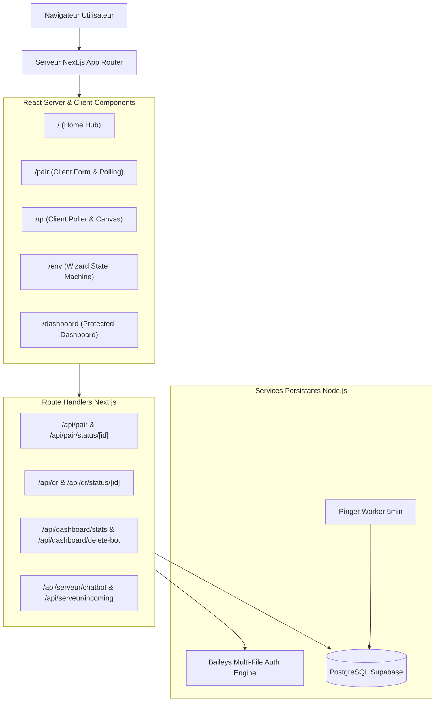

# Document de Passation Technique — Migration vers Next.js (App Router)

> **Projet :** MENMA-MD / Session Web  
> **Auteur :** Antigravity AI  
> **Date de rédaction :** 18 Octobre 2026  
> **Statut :** Prêt pour migration  

---

## 1. Vue d'Ensemble & Objectifs

Ce document détaille l'état actuel de l'application **MENMA-MD Session Web** et fournit la feuille de route exhaustive, l'architecture cible et les étapes pas à pas pour réaliser la migration vers **Next.js (App Router, TypeScript, Tailwind CSS / CSS moderne)**.

### Objectifs de la migration
1. **Modernisation Frontend :** Passer de fichiers HTML/JS statiques avec manipulation DOM impérative vers des composants React / TypeScript déclaratifs, typés et modulaires.
2. **Architecture Full-stack unifiée :** Remplacer les routes Express par les *Route Handlers* Next.js (`app/api/**/route.ts`) tout en préservant la logique métier (Baileys, PostgreSQL, Chatbot, Pinger).
3. **Optimisation des performances & UX :** Maintenir le design system sombre "Luxury Gold" sans anti-patterns (validé par `impeccable`), avec rendu optimisé côté client/serveur.
4. **Maintenance & Déploiement :** Simplification du CI/CD, meilleure gestion des variables d'environnement et conteneurisation Docker standard (`standalone`).

---

## 2. Cartographie de l'Existant (Architecture Actuelle)

### 2.1 Pile Technique Actuelle
- **Runtime / Serveur :** Node.js 18+, Express.js 4.21
- **WhatsApp Web API :** `@whiskeysockets/baileys` (v7.0.0-rc11) avec authentification multificier (`useMultiFileAuthState`) stockée temporairement dans `temp/`
- **Base de données :** PostgreSQL (Supabase pooler) via le package `pg`
- **Stockage externe :** `pastebin-js` pour uploader les sessions credentials
- **Frontend :** HTML5 natif, CSS3 personnalisé (`style.css`), Vanilla JS, FontAwesome 6, Chart.js (CDN)

### 2.2 Inventaire des Pages Frontend
| Route Web | Fichier source | Description & Fonctionnalités clés |
| :--- | :--- | :--- |
| `/` | `public/index.html` | Page d'accueil / Hub avec sélection des options (QR, Pair, Env) et animation de particules |
| `/pair` | `public/pair.html` | Saisie numéro international $\rightarrow$ Appel `/api/pair` $\rightarrow$ Affichage du code 8 caractères $\rightarrow$ Polling `/api/pair/status/:id` $\rightarrow$ Récupération & copie du Session ID |
| `/qr` | `public/qr.html` | Génération dynamique du QR code WhatsApp via `/api/qr` $\rightarrow$ Polling de validation $\rightarrow$ Réception et copie du Session ID |
| `/env` | `public/env.html` | Wizard interactif en 4 étapes pour générer un fichier `.env` configuré avec aperçu dynamique en temps réel, validation et copie/téléchargement |
| `/dashboard` | `public/dashboard.html` | Tableau de bord de télémétrie protégé par mot de passe : métriques en temps réel (total, en ligne, hors ligne, uptime), graphiques pays/plateformes, liste filtrable/recherche des bots et suppression |

### 2.3 Inventaire des Endpoints & Services Backend
| Endpoint / Service | Fichier | Description |
| :--- | :--- | :--- |
| `GET /api/pair?number=` | `pair.js` | Initialise un socket Baileys, demande un pairing code avec rate-limiting (max 3/min) |
| `GET /api/pair/status/:id` | `pair.js` | Renvoie le statut de la session (`waiting`, `success`, `error`) et le Session ID chiffré |
| `GET /api/qr?id=` | `qr.js` | Génère et renvoie le flux image PNG du QR code WhatsApp |
| `GET /api/qr/status/:id` | `qr.js` | Polling du statut de validation de scan QR |
| `POST /api/dashboard/stats` | `dashboard.js` | Authentification mot de passe et extraction des statistiques PostgreSQL (`active_bots`) |
| `POST /api/dashboard/delete-bot` | `dashboard.js` | Suppression d'un bot dans la base de données |
| `GET /serveur/incoming` | `serveur.js` | Webhook de réception des réponses IA externes |
| `GET /serveur/chatbot` | `serveur.js` | Long-polling entre client web et passerelle `webapi.ai` |
| `startPinger()` | `pinger.js` | Tâche d'arrière-plan (intervalle 5 min) qui ping `/health` sur chaque bot en ligne et met à jour PostgreSQL |
| Self-ping anti-sleep | `index.js` | Ping toutes les 4 minutes pour éviter la mise en veille sur Koyeb/Render gratuit |

---

## 3. Contraintes Critiques & Choix d'Architecture Next.js

> [!WARNING]
> **Attention majeure : Environnement Serverless vs Processus Persistant**  
> Les sockets Baileys (`@whiskeysockets/baileys`), le long-polling in-memory (`Map` des waiters du chatbot) et la boucle de fond `pinger.js` nécessitent un **processus Node.js persistant** avec accès au système de fichiers (`temp/`).  
> Si vous déployez sur **Vercel** ou une plateforme serverless pure, ces fonctionnalités ne fonctionneront pas correctement en raison de l'extinction automatique des lambdas.

### Stratégie Recommandée : Déploiement Standalone (Docker / VPS / Koyeb / Render)
Conserver Next.js déployé en mode **Node.js Server Standalone** (`output: 'standalone'` dans `next.config.js`). Cela permet d'exécuter à la fois le serveur Next.js React et les services persistants (Pinger, Baileys, WebSocket).



---

## 4. Arborescence Cible dans Next.js

```text
session-web/
├── app/
│   ├── layout.tsx              # Root Layout (polices DM Sans / Mono, balises meta, container global)
│   ├── page.tsx                # Accueil (ex index.html)
│   ├── pair/
│   │   └── page.tsx            # Formulaire et affichage du code de couplage
│   ├── qr/
│   │   └── page.tsx            # Scan QR Code dynamique
│   ├── env/
│   │   └── page.tsx            # Générateur de configuration .env interactif
│   ├── dashboard/
│   │   └── page.tsx            # Dashboard télémétrie admin
│   └── api/
│       ├── pair/
│       │   ├── route.ts        # GET /api/pair (génération du code)
│       │   └── status/[id]/
│       │       └── route.ts    # GET /api/pair/status/:id
│       ├── qr/
│       │   ├── route.ts        # GET /api/qr (flux image QR)
│       │   └── status/[id]/
│       │       └── route.ts    # GET /api/qr/status/:id
│       ├── dashboard/
│       │   ├── stats/
│       │   │   └── route.ts    # POST /api/dashboard/stats
│       │   └── delete-bot/
│       │       └── route.ts    # POST /api/dashboard/delete-bot
│       └── serveur/
│           ├── chatbot/
│           │   └── route.ts    # GET /api/serveur/chatbot
│           └── incoming/
│               └── route.ts    # GET /api/serveur/incoming
├── components/
│   ├── ui/
│   │   ├── Button.tsx          # Boutons primary/secondary réutilisables
│   │   ├── CodeBox.tsx         # Affichage monospacé du code / session ID avec bouton Copier
│   │   └── ParticleBackground.tsx # Animation de particules discrètes en arrière-plan
│   ├── dashboard/
│   │   ├── StatCard.tsx        # Carte métrique (Total, En Ligne, Koyeb, Render, VPS)
│   │   ├── BotTable.tsx        # Tableau filtrable et détails déroulants
│   │   ├── AnalyticsCharts.tsx # Graphiques Chart.js ou Recharts
│   │   └── AuthModal.tsx       # Modale d'accès par mot de passe
│   └── env/
│       ├── StepperProgress.tsx # Barre d'étapes (1 à 4)
│       └── LivePreview.tsx     # Aperçu dynamique du fichier .env
├── lib/
│   ├── db.ts                   # Client pool PostgreSQL singleton
│   ├── baileys.ts              # Logique et gestionnaires de session Baileys
│   ├── pinger.ts               # Worker d'arrière-plan du pinger
│   └── pastebin.ts             # Service d'export Pastebin
├── public/                     # Favicons, logos, icônes statiques
├── styles/
│   └── globals.css             # Design tokens impeccables (:root, dark luxury gold, WCAG AA)
├── next.config.mjs             # Configuration Next.js (output standalone)
├── package.json
└── tsconfig.json
```

---

## 5. Plan de Migration Étape par Étape

### Étape 1 : Initialisation de Next.js
Dans un nouveau dossier ou en refactorisant le dépôt :
```bash
npx create-next-app@latest . --typescript --tailwind --app --src-dir=false --eslint
```
Ajouter les dépendances nécessaires :
```bash
npm install @whiskeysockets/baileys pino qrcode pg axios pastebin-js fs-extra lucide-react
npm install --save-dev @types/pg @types/qrcode @types/fs-extra
```

### Étape 2 : Migration du Design System (`globals.css`)
Transposer fidèlement les variables CSS actuelles sans réintroduire les anti-patterns précédemment corrigés :
```css
:root {
  --bg-dark: #0a0a0c;
  --bg-card: rgba(16, 16, 20, 0.85);
  --accent: #C8A84B;
  --accent-dim: #b8952c;
  --accent-muted: rgba(200, 168, 75, 0.15);
  --surface: rgba(18, 18, 22, 0.8);
  --border: rgba(255, 255, 255, 0.10);
  --border-accent: rgba(200, 168, 75, 0.35);
  --text: #f0ede8;
  --text-dim: rgba(240, 237, 232, 0.70);
  --text-muted: rgba(240, 237, 232, 0.50);
}
```

### Étape 3 : Migration des Route Handlers (`app/api/**/route.ts`)
Exemple de conversion Express $\rightarrow$ Next.js App Router pour le Dashboard :

```typescript
// app/api/dashboard/stats/route.ts
import { NextResponse } from 'next/server';
import { pool } from '@/lib/db';

const DASHBOARD_PASSWORD = process.env.DASHBOARD_PASSWORD;

export async function POST(request: Request) {
  try {
    const { password } = await request.json();

    if (!password || password !== DASHBOARD_PASSWORD) {
      return NextResponse.json({ error: 'Mot de passe incorrect.' }, { status: 401 });
    }

    const client = await pool.connect();
    try {
      const totalRes = await client.query('SELECT COUNT(*) FROM active_bots');
      const onlineRes = await client.query('SELECT COUNT(*) FROM active_bots WHERE is_online = TRUE');
      const countriesRes = await client.query('SELECT country, COUNT(*) as count FROM active_bots GROUP BY country ORDER BY count DESC');
      const platformsRes = await client.query(`SELECT COALESCE(platform, 'Autre') as platform, COUNT(*) as count FROM active_bots GROUP BY platform ORDER BY count DESC`);
      const botsRes = await client.query(`SELECT session_id, owner_name, owner_number, country, platform, bot_url, is_online, uptime_sec, last_active FROM active_bots ORDER BY is_online DESC, last_active DESC`);

      return NextResponse.json({
        total: parseInt(totalRes.rows[0].count, 10),
        totalOnline: parseInt(onlineRes.rows[0].count, 10),
        countries: countriesRes.rows.map(r => ({ country: r.country, count: parseInt(r.count, 10) })),
        platforms: platformsRes.rows.map(r => ({ platform: r.platform, count: parseInt(r.count, 10) })),
        bots: botsRes.rows,
      });
    } finally {
      client.release();
    }
  } catch (err: any) {
    return NextResponse.json({ error: err.message }, { status: 500 });
  }
}
```

### Étape 4 : Gestion du Worker d'Arrière-plan (`startPinger`)
Dans Next.js en mode serveur custom ou instrumentation (`instrumentation.ts`) :
Next.js supporte officiellement le fichier `instrumentation.ts` à la racine pour initialiser des workers au démarrage du serveur Node.js :

```typescript
// instrumentation.ts
export async function register() {
  if (process.env.NEXT_RUNTIME === 'nodejs') {
    const { startPinger } = await import('@/lib/pinger');
    startPinger();
    console.log('[INSTRUMENTATION] Pinger de fond initialisé avec succès.');
  }
}
```
Activer l'option dans `next.config.mjs` :
```javascript
/** @type {import('next').NextConfig} */
const nextConfig = {
  output: 'standalone',
  experimental: {
    instrumentationHook: true,
  },
};
export default nextConfig;
```

### Étape 5 : Migration des Pages et Composants React
- **`/env` :** Convertir l'objet d'état monolithique en un hook `useReducer` ou formulaire avec validation Zod.
- **`/pair` & `/qr` :** Utiliser des hooks `useEffect` et des états clairs (`idle`, `loading`, `polling`, `success`, `error`) avec nettoyage automatique des timers (`clearInterval` / `clearTimeout`).
- **Accessibilité :** Conserver les attributs ARIA (`aria-label`, balises sémantiques `<section>`, `<header>`, `<main>`, `<dialog>`).

---

## 6. Variables d'Environnement Requises

Créer un fichier `.env.example` lors de la migration :
```env
# Serveur
PORT=3000
NODE_ENV=production

# Base de données PostgreSQL (Supabase)
PG_USER=postgres.xxxx
PG_PASSWORD=xxxx
PG_HOST=aws-1-eu-central-1.pooler.supabase.com
PG_PORT=6543
PG_DB=postgres

# Dashboard Admin
DASHBOARD_PASSWORD=votre_mot_de_passe_robuste

# Pastebin API
PASTEBIN_API_KEY=EMWTMkQAVfJa9kM-MRUrxd5Oku1U7pgL

# Chatbot AI Gateway
WEBAPI_URL=https://c1878.webapi.ai/cmc/user_message
WEBAPI_AUTH_TOKEN=otznwxdd

# URLs pour self-ping
APP_URL=https://votre-app.koyeb.app
BOT_URL=
```

---

## 7. Critères de Validation & Recette Finale

Avant toute mise en production de la version Next.js, valider les points suivants :
1. [ ] **Audit Design Impeccable :** Exécuter `npx impeccable detect http://localhost:3000` sur chaque page pour s'assurer qu'aucun anti-pattern (contraste, dark-glow, padding) n'a été réintroduit.
2. [ ] **Couplage WhatsApp :** Tester un appairage complet via numéro (`/pair`) et vérifier la réception du code WhatsApp et du Session ID.
3. [ ] **Scan QR Code :** Vérifier l'affichage fluide du QR code sans image cassée (`/qr`) et la détection du scan.
4. [ ] **Générateur .env :** Vérifier que l'aperçu dynamique se met à jour en temps réel et que le fichier `.env` généré est valide.
5. [ ] **Dashboard Télémétrie :** Tester l'authentification par mot de passe, l'exactitude des totaux, les filtres et la suppression d'un bot.
6. [ ] **Pinger autonome :** Confirmer dans les logs que le pinger s'exécute bien toutes les 5 minutes sans bloquer les requêtes web.
7. [ ] **Build Standalone :** Lancer `npm run build` et tester le démarrage via `node .next/standalone/server.js`.
